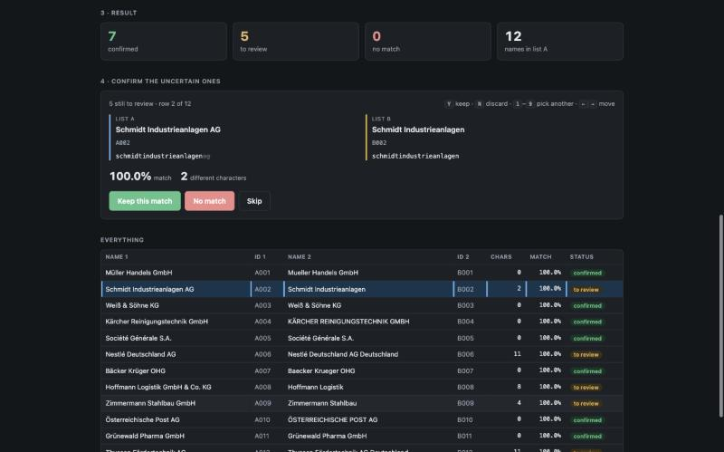

# matchtool

**Fuzzy matching for Excel-style lookups that tolerates typos, umlauts and abbreviations.**

`Müller Handels GmbH` and `Mueller Handels Gesellschaft mit beschränkter Haftung`
are the same company, but a `VLOOKUP` will never tell you that. matchtool will.

## Why it exists

During my internship at Deutsche Bank I built a string-matching tool so colleagues
could reconcile lists the way they would with `VLOOKUP`, even when names were
misspelled or abbreviated. More than 40 people ended up using it. matchtool is my
own rebuild of that idea from scratch: it runs entirely in the browser, and no
data ever leaves the machine.



## What it does

- Drop two Excel or CSV files in, or paste cells straight from Excel.
- Every name is cleaned (case, umlauts, accents, punctuation) and scored against
  the other list. Legal forms such as `GmbH` vs. `Gesellschaft mit beschränkter
  Haftung` still match.
- Results are split into **confirmed**, **to review** and **no match**. A review
  card shows the two names side by side with the differing characters marked,
  and you decide with the keyboard (`Y` / `N`).
- Export to Excel or CSV, with every original column kept.

## Tech stack

- Plain JavaScript (ES modules) with **no dependencies**: the same code runs in
  the browser and under Node.
- A self-written `.xlsx` reader and writer, built on the browser's own deflate.
- A bounded Levenshtein distance plus an exact prefilter: 16 million pairs
  are compared in about 2 seconds.
- A single-file build: the whole app ships as one HTML file that opens with a
  double-click, with no server and no install.
- 39 offline tests, including fuzzing against a reference implementation.

## Run it

Requires [Node.js](https://nodejs.org) 20 or later.

```bash
node build.js        # builds dist/matchtool.html, then just double-click it
```

or, for development:

```bash
node serve.js        # then open http://localhost:8000
node test/test.js    # run the test suite
node cli.js examples/list-a.xlsx examples/list-b.xlsx --out matches.xlsx
```

The algorithm, the metric, performance notes and the full layout are in
[docs/TECHNICAL.md](docs/TECHNICAL.md).

---

© 2026 Ricco Borusiak. All rights reserved.
